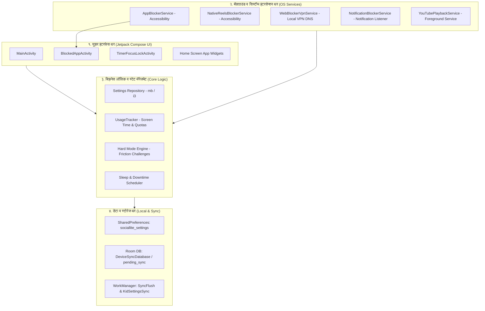

# 00. SocialLite ॲप आर्किटेक्चर आणि तंत्रज्ञान विहंगावलोकन (Architecture & Tech Stack)

## १. ॲप परिचय (Overview)
**SocialLite** हे एक प्रगत Android डिजिटल वेलबीइंग (Digital Wellbeing), फोकस (Focus Enforcer) आणि सोशल मीडिया डिस्ट्रॅक्शन-फ्री (Distraction-Free Social Container) ॲप्लिकेशन आहे. याचा मुख्य उद्देश युजर्सचे सोशल मीडिया अडिक्शन (Instagram, YouTube, TikTok, X/Twitter, Facebook, Snapchat, Reddit) कमी करणे, इन्फिनाईट रील्स/शॉर्ट्स स्क्रोलिंग बंद करणे आणि रात्रीच्या झोपेचे वेळापत्रक (Bedtime Sleep Mode) सुरक्षित ठेवणे हा आहे.

---

## २. संपूर्ण तंत्रज्ञान स्टॅक (Technology Stack)

| घटक (Component) | तंत्रज्ञान / लायब्ररी (Technology / Library) | स्पष्टीकरण (Details) |
|---|---|---|
| **Programming Language** | Kotlin & Java | संपूर्ण ॲप मॉडर्न कोटलिन कोरोटिन्स आणि आर्किटेक्चरवर आधारित आहे. |
| **UI Framework** | **Jetpack Compose** (`androidx.compose`) | संपूर्ण UI 100% डिक्लेरेटिव्ह जेटपॅक कंपोजमध्ये डिझाइन केलेले आहे (`ComponentActivity.setContent`). |
| **App Architecture** | MVVM + Repository Pattern | UI State (`SnapshotStateKt.mutableStateOf`), Coroutines (`kotlinx.coroutines`), Shared Flows. |
| **Local Database** | **Room Database** (`androidx.room`) | ऑफलाइन म्यूटेशन ट्रॅकिंग (`DeviceSyncDatabase`, `pending_sync_queue`). |
| **Background Processing** | **Android WorkManager** (`androidx.work`) | बॅकग्राउंड सिंकिंग (`KidSettingsSyncWorker`, `SyncFlushWorker`, `BillingCheckWorker`). |
| **Native Interception** | **Accessibility Services** (`AccessibilityService`) | १) ॲप्स ब्लॉक करणे (`AppBlockerService`) २) इन्स्टंट रील्स/शॉर्ट्स ब्लॉक करणे (`NativeReelsBlockerService`). |
| **Network & DNS Filtering** | **VpnService** (`android.net.VpnService`) | लोकल VPN टनेलद्वारे पोर्ट 53 DNS पॅकेट्स इंटरसेप्ट करून अडल्ट व सोशल वेबसाईट्स सिस्टीम-वाईड ब्लॉक करणे. |
| **Notification Engine** | **NotificationListenerService** | ॲडिक्टिव्ह ॲप्सचे नोटिफिकेशन्स कॅन्सल करून डिस्ट्रॅक्शन-फ्री सोशललाईट नोटिफिकेशन्स पाठवणे. |
| **Anti-Uninstall Engine** | **Device Administration** (`DeviceAdminReceiver`) | युजरने फोकस मोड चालू असताना ॲप अनइन्स्टॉल करू नये म्हणून डिव्हाइस ॲडमिन लॉक. |
| **Media Playback Engine** | Foreground Service + Media Playback | YouTube साठी बॅकग्राउंड ऑडिओ प्लेबॅक आणि वेक-लॉक (`YouTubePlaybackService`). |
| **WebView Engine** | Android WebView + Custom JS Injection | वेब क्लायंटमध्ये रील्स टॅब, अल्गोरिदम फीड, ॲड्स लपवण्यासाठी कस्टम जावास्क्रिप्ट आणि CSS इंजेक्शन. |
| **Billing & Monetization** | Google Play Billing Client 8.0.0 + RevenueCat | प्रो सबस्क्रिप्शन, फ्री ट्रायल, ऑफर कोड्स, इन-ॲप परचेस. |

---

## ३. हाय-लेव्हल आर्किटेक्चर आकृती (System Architecture Flow)

---

## ४. ॲपचे मुख्य कॉम्पोनंट्स (Key Manifest Components)

1. `com.sociallite.android.MainActivity`: मुख्य लाँचर ॲक्टिव्हिटी, डीप लिंक्स (`sociallite://open?platform=...`, `sociallite://upgrade`), पिक्चर-इन-पिक्चर (PiP) सपोर्ट.
2. `com.sociallite.android.data.AppBlockerService`: एक्सेसिबिलिटी सर्व्हिस जी फोरग्राउंड ॲप्सवर लक्ष ठेवते आणि ब्लॉक केलेल्या ॲप्सना तात्काळ रोखते.
3. `com.sociallite.android.data.NativeReelsBlockerService`: मूळ Instagram, YouTube ॲप्समधील रील्स/शॉर्ट्स नोड्स डिटेक्ट करून त्वरित बंद करणारी सर्व्हिस.
4. `com.sociallite.android.data.WebBlockerVpnService`: लोकल DNS सिंकहोल व्हीपीएन, जे ब्राऊझरमधील सोशल वेबसाईट्स ब्लॉक करते.
5. `com.sociallite.android.data.NotificationBlockerService`: सोशल ॲप्सचे नोटिफिकेशन्स इंटरसेप्ट करून फिल्टर करणारी सर्व्हिस.
6. `com.sociallite.android.data.UninstallProtectionReceiver`: डिव्हाइस ॲडमिनद्वारे ॲप अनइन्स्टॉलेशन रोखणारा कॉम्पोनंट.
7. `com.sociallite.android.TimerFocusLockActivity`: फोनच्या लॉकस्क्रीनवर टायमर आणि फोकस मोड दाखवणारी ॲक्टिव्हिटी (`setShowWhenLocked=true`).
