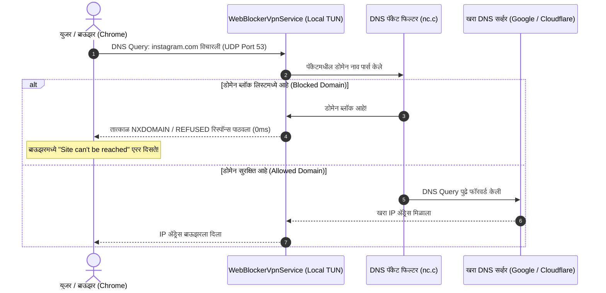

# 04. सिस्टीम-वाईड वेब आणि DNS ब्लॉकर (System-Wide Web & DNS Blocker)

## १. फिचरचे काम (What It Does)
अनेक हुशार युजर्स जेव्हा ॲप्स ब्लॉक होतात, तेव्हा फोनच्या ब्राऊझरमध्ये (Google Chrome, Samsung Internet, Firefox, Edge) जाऊन सोशल मीडियाच्या वेबसाईट्स (उदा. `instagram.com`, `youtube.com`, `tiktok.com`, `reddit.com`) वापरू लागतात.

SocialLite चे **WebBlockerVpnService** हे संपूर्ण फोनवरील कोणत्याही ब्राऊझरमधील सोशल मीडिया आणि व्यसनाधीन वेबसाईट्स ब्लॉक करते.

विशेष म्हणजे:
- हे कोणत्याही **बाहेरील सर्व्हरवर डेटा पाठवत नाही (100% On-Device, Privacy-First)**.
- हे फोनमध्येच एक **स्थानिक व्हर्च्युअल VPN (Local Virtual TUN Interface)** तयार करते.
- हे फक्त **DNS (Domain Name System) पॅकेट्स (Port 53)** तपासते, ज्यामुळे फोनचा इंटरनेट स्पीड अजिबात कमी होत नाही आणि बॅटरी खर्च होत नाही.

---

## २. ब्लॉक केलेल्या डोमेन्सची यादी (Blocked Domains)

SocialLite खालील सोशल मीडिया डोमेन्स आणि त्यांच्या सर्व सब-डोमेन्सना सिस्टीम-वाईड ब्लॉक करते:
- `*.instagram.com`
- `*.youtube.com`, `*.youtu.be`
- `*.tiktok.com`
- `*.twitter.com`, `*.x.com`
- `*.facebook.com`, `*.fb.com`
- `*.snapchat.com`
- `*.reddit.com`
- युजरने ॲड केलेले कस्टम डोमेन्स (Custom Blocked Websites)

---

## ३. हाय-लेव्हल कार्यप्रणाली (High-Level Architecture)

