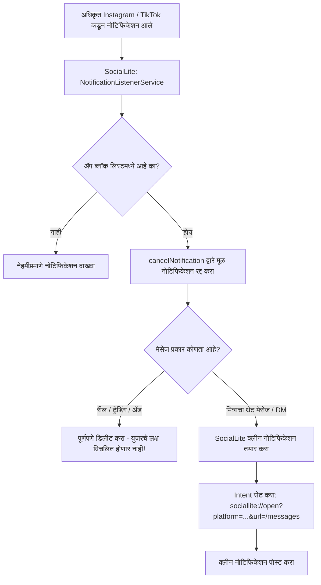

# 05. नोटिफिकेशन ब्लॉकर आणि सॅनिटायझर (Notification Blocker & Sanitizer)

## १. फिचरचे काम (What It Does)
सोशल मीडिया ॲप्स (उदा. Instagram, Facebook, Snapchat) युजर्सना पुन्हा पुन्हा ॲपमध्ये खेचून आणण्यासाठी सतत आकर्षक नोटिफिकेशन्स पाठवत राहतात (उदा. *"X posted a new reel", "Check out trending videos", "Someone you may know is on Instagram"*). हे नोटिफिकेशन्स युजरचा फोकस पूर्णपणे नष्ट करतात.

SocialLite चे **NotificationBlockerService**:
1. मूळ ॲप्समधून येणारे **सर्व व्यसनाधीन नोटिफिकेशन्स सिस्टीम ट्रे मधून तात्काळ कॅन्सल (Dismiss) करते**.
2. जर तो एखाद्या मित्राचा महत्त्वाचा डायरेक्ट मेसेज (DM) असेल, तर SocialLite त्याला **सॅनिटाइज (Sanitize)** करते.
3. त्या नोटिफेक्शनवर क्लिक केल्यावर मूळ Instagram उघडण्याऐवजी **SocialLite चे डिस्ट्रॅक्शन-फ्री मेसेजिंग पेज उघडते (`sociallite://open?platform=instagram&url=/messages`)**.

---

## २. टार्गेट ॲप्स आणि चॅनेल्स (Target Apps Mapping)

`NotificationBlockerService.java` मधील मॅपिंग:
```java
// टार्गेट पॅकेजेस:
public static final Map<String, String> f3516t = Map.of(
    "com.instagram.android", "instagram",
    "com.google.android.youtube", "youtube",
    "com.zhiliaoapp.musically", "tiktok",
    "com.ss.android.ugc.trill", "tiktok",
    "com.snapchat.android", "snapchat",
    "com.twitter.android", "twitter",
    "com.twitter.android.lite", "twitter",
    "com.facebook.katana", "facebook",
    "com.facebook.orca", "facebook", // Facebook Messenger
    "com.linkedin.android", "linkedin"
);
```

---

## ३. सॅनिटायझेशन प्रवाह (Sanitization Workflow)


