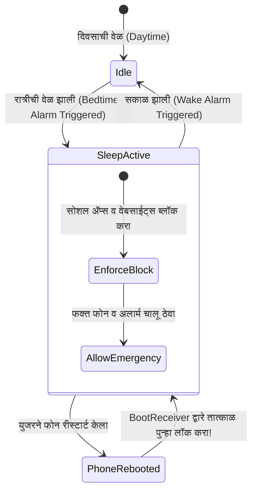

# 07. स्लीप मोड आणि बेडटाईम डाऊनटाईम (Sleep Mode & Bedtime Downtime)

## १. फिचरचे काम (What It Does)
रात्री झोपताना अंथरुणात फोन स्क्रोल करणे ही जगभरातील सर्वात मोठी समस्या आहे. SocialLite चा **Sleep Mode** युजरला रात्रीच्या वेळी फोनपासून दूर ठेवून शांत झोप घेण्यास मदत करतो:
1. **शेड्युल केलेली झोपेची वेळ (Bedtime Window)**:
   - युजर बेडटाईम (उदा. रात्री 10:30 PM) आणि वेक-अप टाईम (उदा. सकाळी 6:30 AM) ठरवतो.
   - ठरलेल्या वेळेला स्लीप मोड आपोआप सक्रिय होतो.
2. **सक्तीचे ब्लॉकिंग (Strict Lockdown)**:
   - झोपेच्या वेळेत सर्व सोशल मीडिया ॲप्स आणि व्यसनाधीन वेबसाईट्स सक्तीने बंद केल्या जातात.
   - जर युजरने ॲप उघडण्याचा प्रयत्न केला, तर स्क्रीनवर येते: *"Sleep mode is active — go to bed."*
3. **नेहमी चालू राहणारे ॲप्स (Always Allowed Apps)**:
   - रात्री इमर्जन्सी येऊ शकते, म्हणून Phone (कॉलिंग), Messages, आणि Clock (अलार्म) हे ॲप्स नेहमी सुरू राहतात (`sleepAllowedPackages`).

---

## २. रिबूट आणि टाईम-झोन सुरक्षा (Reboot & Time Manipulation Defense)

अनेक युजर्स ब्लॉकिंग टाळण्यासाठी फोन रीस्टार्ट करतात किंवा फोनचे घड्याळ (Time & Date) बदलतात. SocialLite खालील ट्रिगर्स ऐकून त्वरित स्लीप मोड रीस्टोअर करते:
- `android.intent.action.BOOT_COMPLETED` (फोन चालू होताच)
- `android.intent.action.LOCKED_BOOT_COMPLETED` (फोन पासवर्ड टाकण्यापूर्वीच)
- `android.intent.action.TIME_SET` (युजरने मॅन्युअली वेळ बदलल्यास)
- `android.intent.action.TIMEZONE_CHANGED` (टाईमझोन बदलल्यास)
- `android.intent.action.MY_PACKAGE_REPLACED` (ॲप अपडेट झाल्यावर)

---

## ३. स्लीप मोड स्टेट फ्लो (Sleep Mode Flow Diagram)

