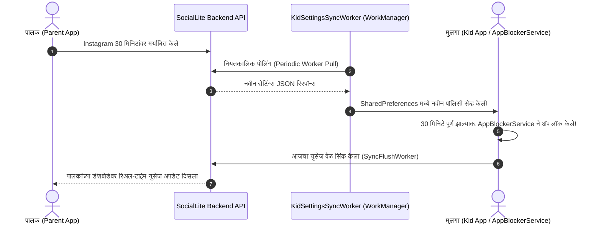

# 08. पॅरेंटल कंट्रोल्स आणि लिंक्ड किड (Parental Controls - LinkedKid)

## १. फिचरचे काम (What It Does)
SocialLite मध्ये मुलांच्या फोन वापरावर नियंत्रण ठेवण्यासाठी एक संपूर्ण **पॅरेंटल कंट्रोल इकोसिस्टम (Parental Control Ecosystem)** तयार केलेली आहे:
1. **पेअरिंग कोड (Device Pairing)**:
   - पालकांच्या फोनमध्ये ६-अंकी कोड तयार होतो (`connectkid_generate_code`).
   - मुलाच्या फोनमध्ये तो कोड टाकून दोन्ही फोन्स सुरक्षितपणे लिंक केले जातात.
2. **रिमोट ॲप ब्लॉकिंग (Remote App Blocking)**:
   - पालक त्यांच्या स्वतःच्या फोनवरून मुलाच्या फोनमधील Instagram, YouTube, TikTok, गेम्स ब्लॉक करू शकतात.
3. **प्लॅटफॉर्म युसेज मॉनिटरिंग (Platform Usage Analytics)**:
   - मुलाने आज किती मिनिटे फोन वापरला, कोणत्या ॲपवर किती वेळ घालवला याचा थेट डेटा पालकांना दिसतो (`todayUsageMinutes`, `platformUsage`).
4. **डाऊनटाईम शेड्युल (Downtime Schedule)**:
   - मुलांच्या अभ्यासाच्या वेळेत किंवा रात्रीच्या झोपेच्या वेळी फोन पूर्णपणे लॉक करण्याचे वेळापत्रक.
5. **क्रॉस-प्लॅटफॉर्म सपोर्ट (Cross-Platform iOS & Android)**:
   - पालकांकडे iPhone आणि मुलाकडे Android असले तरी हे सहज काम करते (`devicePlatform`).

---

## २. डेटा मॉडेल (`LinkedKid.java`)

`decompiled_sociallite/sources/com/sociallite/android/data/LinkedKid.java` मधील मॉडेल:

```kotlin
data class LinkedKid(
    val code: String,                 // पेअरिंग कोड (उदा. "SL-88421")
    val nickname: String,             // मुलाचे नाव (उदा. "Alex")
    val status: String,               // "active" किंवा "pending"
    val linkedAt: String,             // लिंक्ड तारीख
    val createdAt: String,            // प्रोफाईल तयार झाल्याची तारीख
    val todayUsageMinutes: Int,       // आजचा एकूण वापर (मिनिटांत)
    val settings: JSONObject?,        // रिमोट पॉलिसी सेटिंग्स
    val timeLimits: JSONObject?,      // प्रति-ॲप वेळ मर्यादा
    val downtimeSchedule: JSONObject?,// अभ्यास व झोपेचे वेळापत्रक
    val platformUsage: List<PlatformUsage>, // Instagram, YouTube इत्यादींचा स्वतंत्र वापर
    val devicePlatform: String?       // "android" किंवा "ios"
)
```

---

## ३. रिमोट सिंकिंग आर्किटेक्चर (Sync Architecture Flow)


