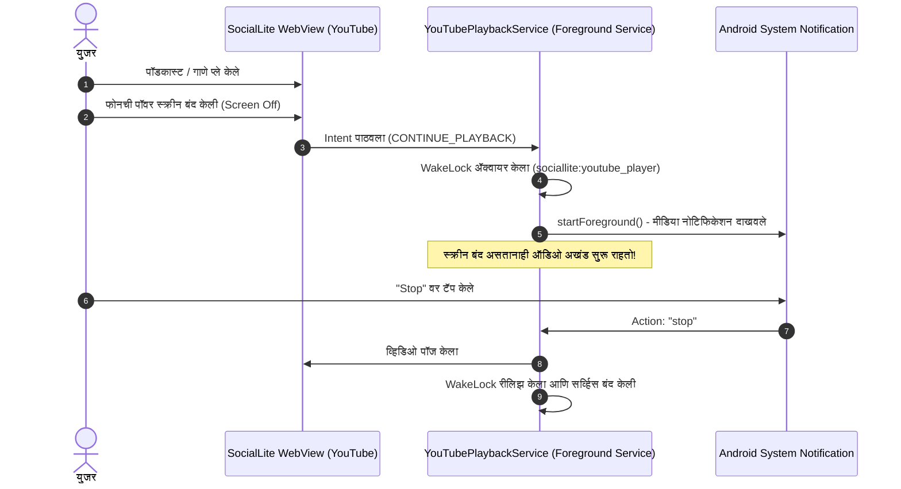

# 10. युट्यूब बॅकग्राउंड ऑडिओ प्लेबॅक (YouTube Background Audio Playback)

## १. फिचरचे काम (What It Does)
YouTube ॲपमध्ये बॅकग्राउंडमध्ये ऑडिओ प्ले करणे (उदा. पॉडकास्ट, संगीत, व्याख्याने ऐकणे) हे फक्त YouTube Premium युजर्ससाठी उपलब्ध असते. मोफत युजर्सने स्क्रीन बंद केली की व्हिडिओ तात्काळ थांबतो.

SocialLite युजर्सना फोनची **स्क्रीन बंद असताना किंवा दुसरे काम करत असताना युट्यूब व्हिडिओ बॅकग्राउंडमध्ये ऐकण्याची मोफत सुविधा देते**:
1. जेव्हा युजर SocialLite मध्ये युट्यूबवर एखादे गाणे किंवा पॉडकास्ट लावतो आणि स्क्रीन बंद करतो:
   - ऑडिओ चालूच राहतो.
2. स्टेटस बारमध्ये **Media Notification** दिसते (ज्यात "YouTube is playing", "Stop" बटण आणि ॲपमध्ये परत जाण्याची लिंक असते).
3. फोन स्लीप मोडमध्ये जाऊन ऑडिओ कट होऊ नये म्हणून **CPU WakeLock** चालू ठेवला जातो.

---

## २. कार्यप्रणाली प्रवाह (Playback Lifecycle)

