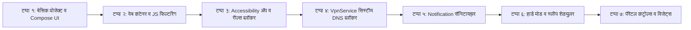

# 14. स्वतःचे SocialLite ॲप बनवण्याचा संपूर्ण मार्गदर्शक (Replication Roadmap & Build Guide)

## १. परिचय (Introduction)
या रिव्हर्स इंजिनिअरिंग दस्तऐवजीकरणाचा मुख्य हेतू म्हणजे **आपण स्वतःचे अशाच प्रकारचे आधुनिक, शक्तिशाली आणि खाजगी डिजिटल वेलबीइंग ॲप्लिकेशन विकसित करू शकू**.

खाली टप्प्याटप्प्याने (Phase by Phase) संपूर्ण ॲप विकसित करण्याचा रोडमॅप दिला आहे.

---

## २. संपूर्ण विकास टप्पे (Step-by-Step Implementation Roadmap)

---

### टप्पा १: प्रोजेक्ट सेटअप व कंपोज डिझाइन सिस्टीम (Foundation)
1. **नवीन Android Studio प्रोजेक्ट**:
   - Package Name: उदा. `com.mywellbeing.app`
   - Language: **Kotlin**
   - Minimum SDK: **API 26 (Android 8.0)**, Target SDK: **API 35/36 (Android 15/16)**.
   - Build Toolkit: Gradle Version Catalog (`libs.versions.toml`).
2. **लायब्ररी डिपेन्डेन्सीज**:
   - Jetpack Compose (BOM, Material3, Navigation Compose)
   - Coroutines & Lifecycle ViewModel
   - Room Database & KSP
   - WorkManager (`androidx.work:work-runtime-ktx`)
3. **थीम तयार करणे**:
   - `00_Architecture_Overview` आणि `13_UI_UX_Design_and_Theming` नुसार डार्क आणि लाईट कलर पॅलेट डिझाइन करा.

---

### टप्पा २: डिस्ट्रॅक्शन-फ्री वेब कंटेनर विकसित करणे (Web Container)
1. `WebView` रॅपर तयार करा.
2. `apktool_out/assets/` मधील जावास्क्रिप्ट फाइल्स:
   - `instagram/feed_response_filter.js` (GraphQL ॲड आणि सजेस्टेड पोस्ट्स रिमूव्हर)
   - `youtube/personal.js` (शॉर्ट्स आणि होम फीड ब्लॉकर)
3. `WebViewClient` मध्ये `shouldOverrideUrlLoading` वापरून `/reels/` आणि `/shorts/` पाथ्स ब्लॉक करा.
4. YouTube बॅकग्राउंड ऑडिओसाठी `ForegroundService` आणि `WakeLock` जोडा (`10_YouTube_Background_Playback`).

---

### टप्पा ३: नेटिव्ह ॲप आणि रील्स ब्लॉकर (Accessibility Services)
1. **ॲप ब्लॉकर (`AppBlockerService`)**:
   - `AccessibilityService` तयार करा.
   - फोरग्राउंड पॅकेज नाव ओळखा.
   - जर ते Instagram/YouTube/TikTok असेल, तर `BlockedAppActivity` लाँच करा.
2. **इन-ॲप रील्स ब्लॉकर (`NativeReelsBlockerService`)**:
   - `clips_viewer_view_pager` आणि `reel_recycler` हे नोड आयडीज ओळखा.
   - रील्स उघडताच `GLOBAL_ACTION_BACK` किंवा स्वाइप जेस्चर ट्रिगर करा.

---

### टप्पा ४: सिस्टीम-वाईड DNS वेब ब्लॉकर (VpnService)
1. `VpnService` सबक्लास करून लोकल VPN टनेल तयार करा.
2. IP पॅकेट्समधील UDP Port 53 वाचून DNS डोमेन्स पार्स करा.
3. जर डोमेन `instagram.com` किंवा `tiktok.com` असेल, तर थेट NXDOMAIN पॅकेट तयार करून पाठवा (`04_SystemWide_DNS_Web_Blocker`).

---

### टप्पा ५: नोटिफिकेशन सॅनिटायझर (Notification Interceptor)
1. `NotificationListenerService` तयार करा.
2. सोशल ॲप्सचे सतत येणारे विचलित करणारे नोटिफिकेशन्स रद्द करा (`cancelNotification`).
3. महत्त्वाच्या DMs साठी स्वच्छ, शांत नोटिफिकेशन दाखवा आणि थेट मेसेज इनबॉक्सची लिंक द्या.

---

### टप्पा ६: हार्ड मोड, स्लीप मोड आणि अनइन्स्टॉल सुरक्षा
1. **हार्ड मोड फ्रिक्शन**:
   - ६० सेकंद कूलडाउन टायमर
   - प्रतिज्ञा टाईपिंग
   - ५ गणिताचे प्रश्न सोडवणे
   - २ बोटे स्क्रीनवर ५ सेकंद धरून ठेवणे
2. **स्लीप मोड**: `AlarmManager.setExactAndAllowWhileIdle()` वापरून बेडटाईम आणि वेक अलार्म्स शेड्युल करा.
3. **अनइन्स्टॉल सुरक्षा**: `DeviceAdminReceiver` इंटिग्रेट करा जेणेकरून युजर फोकस दरम्यान ॲप अनइन्स्टॉल करू शकणार नाही.

---

### टप्पा ७: पॅरेंटल कंट्रोल्स, विजेट्स आणि गॅमिफिकेशन
1. पालकांसाठी ६-अंकी पेअरिंग कोड आणि रिमोट पॉलिसी सिंकिंग तयार करा (`LinkedKid`).
2. ऑफलाइन युसेज साठवण्यासाठी Room Database मध्ये `pending_sync_queue` वापरा.
3. होमस्क्रीनवरून १-टॅप क्लीन लाँचसाठी `AppWidgetProvider` विजेट्स बनवा.
4. युजर्सना प्रेरित ठेवण्यासाठी १८ अचिव्हमेंट्स आणि स्ट्रीक ट्रॅकिंग सिस्टम जोडा.

---

## ३. सारांश (Summary)
हे १४ मॉड्यूल्स एकत्रित करून आपण एक जागतिक दर्जाचे, सुरक्षित आणि प्रभावी डिजिटल वेलबीइंग ॲप्लिकेशन यशस्वीपणे तयार करू शकतो!
